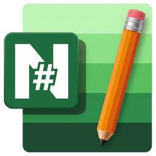

<div align="center">
  <a href="https://github.com/alsyundawy/NotepadNext-MacOS">
    
  </a>
  <h1>🍎 NotepadNext For MacOS — Notepad++ Like</h1>
</div>

> 🇬🇧 A cross-platform reimplementation of Notepad++ — built natively for macOS.
>
> 🇮🇩 Implementasi ulang Notepad++ lintas platform — dibangun secara native untuk macOS.

[](doc/RELEASE_NOTES_0.15-07.md)


[](https://github.com/alsyundawy/NotepadNext-MacOS/releases)
[](#localization--language-support)
[](https://github.com/alsyundawy/NotepadNext-MacOS/)
[](https://github.com/alsyundawy/NotepadNext-MacOS/blob/master/LICENSE)
[](https://github.com/alsyundawy/NotepadNext-MacOS/issues)
[](https://github.com/alsyundawy/NotepadNext-MacOS/pulls)
[](https://www.paypal.me/alsyundawy)
[](https://github.com/user-attachments/assets/a0126f28-6dde-43da-ba14-d7c9a27de0df)
[](https://github.com/sponsors/alsyundawy)
[](https://github.com/alsyundawy/NotepadNext-MacOS/stargazers)
[](https://github.com/alsyundawy/NotepadNext-MacOS/network/members)
[](https://github.com/alsyundawy/NotepadNext-MacOS/graphs/contributors)

---


---

## Overview

> 🇬🇧 **NotepadNext For MacOS** is a native macOS reimplementation of Notepad++ built with modern Qt 6. It provides fast editing performance, syntax highlighting across 470+ file formats, tabbed document workflows, Gatekeeper support, and native Indonesian & English localization.
>
> 🇮🇩 **NotepadNext For MacOS** adalah implementasi ulang native Notepad++ untuk macOS yang dibangun menggunakan Qt 6 modern. Aplikasi ini menghadirkan kecepatan tinggi, penyorotan sintaks untuk 470+ format file, manajemen multi-tab dokumen, integrasi sistem macOS, serta pelokalan penuh Bahasa Indonesia dan Bahasa Inggris.

### 🌟 Latest Release Highlights (v0.15-07)

> 🇬🇧 **Version 0.15-07 Enterprise Upgrade:**
>
> - 🛡️ **2025–2026 CVE Mitigations**: SHA-256 package validation (CVE-2025-15556), sandboxed Lua 5.5.1 runtime (CVE-2026-42214), canonical absolute binaries (CVE-2026-25926), and bounded C-string checks (CVE-2025-49144).
> - 🚀 **Tab Lifecycle & Unsaved Tab Crash Resolution**: Resolved critical Use-After-Free / pure-virtual-call crash occurring when closing unsaved documents in `DockedEditor.cpp`, guarded `MainWindow::updateEditorPositionBasedUi()` against null dock areas, and stabilized document close unwinding using `QPointer<ScintillaNext>`.
> - 🔄 **Upstream Feature Harmonization**: Harmonized upstream PRs including Default Language configuration for new documents in `PreferencesDialog`, Trim Trailing Whitespace action in Blank Operations, centralized `getToolTip()` generation, zero-length regex replace progress advancement, and defensive message handler cleanup.
> - 🍏 **macOS Architecture & Multi-Window**: Single-instance in-process multi-window management with responsive macOS Dock activations, plus Dock right-click quit save prompt (`QEvent::Close`) ensuring dirty and untitled tabs prompt for saving before exit.
> - ⚡ **Advanced Text Editing Power**: Scintilla 5.6.7 Retina pixel-aligned scaling, natural locale-aware numeric sorting (`QCollator`), inline math evaluator (`Cmd+Shift+M`), multi-line paste auto-escaping in Find/Replace, integrated side-by-side file diff, and read-only hex viewer.
> - 🧩 **Stability & Unicode High-Volume Crash Guards**: Fortified tab closures in horizontal/vertical split views and eliminated layout crashes on high-volume documents (>10,000 lines) with compound Unicode 18.0 emojis via bounded PlatQt measurement.
> - 🌐 **100% i18n Modernization**: 0 unfinished entries across Indonesian (`id_ID`) and English (`en_US`) catalogs, fully standardized per EYD V, PUEBI, PASTI, and Mozilla L10n standards.
> - 📦 **Linux CPack Packaging (.deb & .rpm) & Complete Qt 6.5–6.12 CI/CD**: Native Debian and RedHat packages generated via CPack with `.desktop` entry and AppStream metadata across Ubuntu 22.04/24.04 and Fedora, with full build matrix coverage from Qt 6.5 to 6.12.
> - 🎯 **Non-Intrusive Status Bar Zoom & UI Polish**: Replaced intrusive screen-blocking OSD popup with clean `statusBar()->showMessage()` feedback, and resolved Qt 6 macOS palette rendering in `FadingIndicator`.
> - 🔍 **Zero-Defect Code Quality, C++26 Safety & <30MB Packaging**: Resolved Clangd C-mode header parsing (-xc++-header) and SonarQube `.ts` misclassification (eliminating 1,288 IDE errors and 756 SonarQube errors), complete C++26 `std::unique_ptr` lifetime migration for UI classes, scoped enum template serialization, and optimized macOS DMG packaging (~27 MB, strictly <30 MB guarantee).
>
> 🇮🇩 **Peningkatan Enterprise Versi 0.15-07:**
>
> - 🛡️ **Mitigasi CVE 2025–2026**: Validasi paket kriptografis SHA-256 (CVE-2025-15556), kotak pasir runtime Lua 5.5.1 (CVE-2026-42214), kanonikalisasi biner absolut (CVE-2026-25926), dan proteksi batas memori string (CVE-2025-49144).
> - 🚀 **Penyelesaian Crash Siklus Hidup Tab Belum Tersimpan**: Memperbaiki crash fatal Use-After-Free / pure virtual call saat menutup tab belum tersimpan pada `DockedEditor.cpp`, menambahkan pengecekan pointer null pada dock area di `MainWindow::updateEditorPositionBasedUi()`, serta mengamankan unwinding penutupan dokumen dengan `QPointer<ScintillaNext>`.
> - 🔄 **Harmonisasi Fitur Upstream**: Mengintegrasikan fitur upstream termasuk opsi Bahasa Default dokumen baru pada `PreferencesDialog`, aksi Pangkas Spasi Akhir (Trim Trailing Whitespace), tooltip terpusat via `getToolTip()`, perbaikan kemajuan Replace All pada regex berpanjang nol, dan pelepasan handler pesan defensif.
> - 🍏 **Arsitektur macOS & Multi-Jendela**: Pengelolaan multi-jendela in-process dengan responsivitas klik Dock macOS, serta dialog konfirmasi simpan berkas saat keluar dari menu Dock (`QEvent::Close`) untuk melindungi tab yang belum disimpan.
> - ⚡ **Fitur Produktivitas Modern**: Penskalaan Retina sejajar piksel Scintilla 5.6.7, pengurutan baris numerik alami peka-lokal (`QCollator`), kalkulator ekspresi matematika langsung (`Cmd+Shift+M`), auto-escape baris baru pada tempel cari/ganti, perbandingan diff dua buffer terintegrasi, dan viewer heksadesimal/biner.
> - 🧩 **Stabilitas & Pertahanan Crash Emoji Dokumen Besar**: Mengamankan penutupan tab pada mode belah tampilan horizontal/vertikal serta mencegah crash layout pada dokumen bervolume besar (>10.000 baris) dengan emoji majemuk Unicode 18.0 via pengukuran berbatas PlatQt.
> - 🌐 **Pelokalan i18n 100% Sempurna**: 0 entri belum selesai untuk katalog bahasa Indonesia (`id_ID`) dan bahasa Inggris (`en_US`), distandarisasi penuh sesuai kaidah EYD V, PUEBI, glosarium PASTI Badan Bahasa, dan Mozilla L10n.
> - 📦 **Pemaketan Linux CPack (.deb & .rpm) & CI/CD Matriks Lengkap Qt 6.5–6.12**: Paket native Debian dan RedHat diproduksi via CPack dilengkapi integrasi `.desktop` dan metadata AppStream untuk Ubuntu 22.04/24.04 dan Fedora, dengan cakupan matriks rilis penuh Qt 6.5 hingga 6.12.
> - 🎯 **Indikator Zoom Status Bar & Pemolesan UI**: Mengganti pop-up OSD yang menghalangi teks dengan notifikasi status bar non-intrusif yang elegan, serta memperbaiki rendering palet kontras Qt 6 pada `FadingIndicator`.
> - 🔍 **Kualitas Kode Bebas Cacat, Keamanan C++26 & Pengemasan <30MB**: Memperbaiki mode C header Clangd (-xc++-header) dan pengecualian `.ts` SonarQube (melenyapkan 1.288 error IDE dan 756 error SonarQube), migrasi lifetime `std::unique_ptr` C++26 untuk kelas dialog UI, lolos 100% analisis statis, serta optimasi pengemasan DMG macOS (~27 MB, terjamin <30 MB).
>
> 📊 **Cumulative Architecture Matrix & In-Depth Upstream Comparison**: For the comprehensive 21-dimension comparative whitepaper detailing why this edition is vastly superior to official upstream v0.15, see [In-Depth Upstream Comparison](doc/UPSTREAM_COMPARISON.md), [Release Notes 0.15-07](doc/RELEASE_NOTES_0.15-07.md), and [DOCNOTE.md](doc/DOCNOTE.md).

---

## Quickstart

```bash
# macOS: Jadikan NotepadNext sebagai default editor macOS / Set as default editor on macOS
chmod +x NotepadNext-Default-Editor.sh
./NotepadNext-Default-Editor.sh -f

# Linux (Debian, Ubuntu, Fedora, RHEL, openSUSE, Arch, etc.):
chmod +x NotepadNext-Default-Editor-Linux.sh
./NotepadNext-Default-Editor-Linux.sh set
```

---

## Installation

> 🇬🇧 NotepadNext application builds are available for macOS and Linux. You can download the latest build directly from the [Releases](https://github.com/alsyundawy/NotepadNext-MacOS/releases) page. Choose the latest release, then check the **Assets** section at the bottom to download the `.dmg`, `.deb`, or `.rpm` file matching your operating system and hardware architecture.
>
> 🇮🇩 Build aplikasi NotepadNext tersedia untuk macOS dan Linux. Anda dapat mengunduh build terbaru langsung dari halaman [Releases](https://github.com/alsyundawy/NotepadNext-MacOS/releases). Pilih rilis terbaru, lalu lihat bagian **Assets** di bagian bawah untuk mendownload file `.dmg`, `.deb`, atau `.rpm` yang sesuai dengan sistem operasi dan arsitektur perangkat Anda.

### macOS Packages (`.dmg`)

Available canonical and matrix DMG packages for Apple Silicon (`arm64`):

| Package / Paket                      | Architecture / Arsitektur | Minimum macOS       | Qt Version / Versi Qt |
| :----------------------------------- | :------------------------ | :------------------ | :-------------------- |
| `NotepadNext-v0.15-07-arm64.dmg`     | Apple Silicon (arm64)     | macOS 12.0 Monterey | Qt 6.5 (Canonical)    |
| `NotepadNext-macOS-arm64-Qt6.5.dmg`  | Apple Silicon (arm64)     | macOS 12.0 Monterey | Qt 6.5                |
| `NotepadNext-macOS-arm64-Qt6.8.dmg`  | Apple Silicon (arm64)     | macOS 13.0 Ventura  | Qt 6.8                |
| `NotepadNext-macOS-arm64-Qt6.10.dmg` | Apple Silicon (arm64)     | macOS 14.0 Sonoma   | Qt 6.10               |
| `NotepadNext-macOS-arm64-Qt6.11.dmg` | Apple Silicon (arm64)     | macOS 15.0 Sequoia  | Qt 6.11               |
| `NotepadNext-macOS-arm64-Qt6.12.dmg` | Apple Silicon (arm64)     | macOS 15.0 Sequoia  | Qt 6.12               |

Available canonical and matrix DMG packages for Intel (`x86_64`):

| Package / Paket                    | Architecture / Arsitektur | Minimum macOS       | Qt Version / Versi Qt |
| :--------------------------------- | :------------------------ | :------------------ | :-------------------- |
| `NotepadNext-v0.15-07-x64.dmg`     | Intel (x86_64)            | macOS 11.0 Big Sur  | Qt 6.5 (Canonical)    |
| `NotepadNext-macOS-x64-Qt6.5.dmg`  | Intel (x86_64)            | macOS 11.0 Big Sur  | Qt 6.5                |
| `NotepadNext-macOS-x64-Qt6.8.dmg`  | Intel (x86_64)            | macOS 12.0 Monterey | Qt 6.8                |
| `NotepadNext-macOS-x64-Qt6.10.dmg` | Intel (x86_64)            | macOS 13.0 Ventura  | Qt 6.10               |
| `NotepadNext-macOS-x64-Qt6.11.dmg` | Intel (x86_64)            | macOS 14.0 Sonoma   | Qt 6.11               |
| `NotepadNext-macOS-x64-Qt6.12.dmg` | Intel (x86_64)            | macOS 15.0 Sequoia  | Qt 6.12               |

To resolve Gatekeeper quarantine warnings on macOS:

```bash
sudo xattr -cr "NotepadNext-v0.15-07-arm64.dmg"
sudo xattr -rd com.apple.quarantine "NotepadNext-v0.15-07-arm64.dmg"
sudo codesign --force --deep --sign - "NotepadNext-v0.15-07-arm64.dmg"
```

To install using Homebrew:

```bash
brew tap alsyundawy/notepadnext
brew install --no-quarantine notepadnext
```

### Linux Packages (`.deb` & `.rpm`)

Available native Linux CPack distribution packages:

| Package / Paket                     | Format | Distribution / Distribusi                | Architecture / Arsitektur |
| :---------------------------------- | :----- | :--------------------------------------- | :------------------------ |
| `notepadnext_0.15-07_amd64.deb`     | DEB    | Ubuntu 22.04 / 24.04, Debian 12/13, Mint | x86_64 / amd64            |
| `notepadnext_0.15-07_arm64.deb`     | DEB    | Ubuntu ARM, Debian ARM, Raspberry Pi OS  | arm64 / aarch64           |
| `notepadnext-0.15-07-1.x86_64.rpm`  | RPM    | Fedora 40/41/42, RHEL 9/10, openSUSE     | x86_64                    |
| `notepadnext-0.15-07-1.aarch64.rpm` | RPM    | Fedora ARM, openSUSE ARM                 | aarch64                   |

Install on Debian / Ubuntu:

```bash
sudo apt update
sudo apt install ./notepadnext_0.15-07_amd64.deb
```

Install on Fedora / RHEL / CentOS:

```bash
sudo dnf install ./notepadnext-0.15-07-1.x86_64.rpm
```

---

## Dependencies

> 🇬🇧 **System Requirements & Dependencies:**
>
> - **Operating System**: macOS 11.0 (Big Sur) or higher.
> - **Architectures**: Apple Silicon (`arm64`) and Intel (`x86_64`).
> - **Framework**: Qt 6.5, 6.8, 6.10, 6.11, or 6.12 with `Qt6Core5Compat`.
> - **Build Tools**: CMake 3.21+, Ninja, and C++20 compiler (`AppleClang`).
> - **Automation Helper**: `duti` (optional, for LaunchServices file associations).
>
> 🇮🇩 **Kebutuhan Sistem & Dependensi:**
>
> - **Sistem Operasi**: macOS 11.0 (Big Sur) ke atas.
> - **Arsitektur**: Apple Silicon (`arm64`) dan Intel (`x86_64`).
> - **Framework**: Qt 6.5, 6.8, 6.10, 6.11, atau 6.12 dengan `Qt6Core5Compat`.
> - **Build Tools**: CMake 3.21+, Ninja, dan C++20 compiler (`AppleClang`).
> - **Otomatisasi**: `duti` (opsional, untuk pemetaan asosiasi file LaunchServices).

---

## Configuration

> 🇬🇧 **Force-set NotepadNext as the system-wide default text and code editor on macOS.**
>
> By default, macOS binds hundreds of file formats and extensionless documents to TextEdit. We provide an automated, production-ready script (`NotepadNext-Default-Editor.sh`) that associates 470+ developer file extensions and 38 UTIs, unblocks Gatekeeper quarantine flags, rebuilds the LaunchServices cache database, and restarts Finder & Dock in sub-second time.
>
> 🇮🇩 **Jadikan NotepadNext sebagai editor teks dan kode default seluruh sistem di macOS.**
>
> Secara default, macOS menetapkan ratusan format file dan dokumen tanpa ekstensi ke TextEdit. Kami menyediakan skrip otomatis (`NotepadNext-Default-Editor.sh`) yang memetakan 470+ ekstensi file developer dan 38 UTIs, menghapus karantina Gatekeeper, merefresh database LaunchServices, dan me-restart Finder & Dock secara instan (<0.3 detik).

### Features & Capabilities / Fitur & Keunggulan

| Feature / Fitur             | 🇬🇧 Description                                                                                   | 🇮🇩 Deskripsi                                                                                    |
| :-------------------------- | :----------------------------------------------------------------------------------------------- | :---------------------------------------------------------------------------------------------- |
| ⚡ **Batch Engine (<0.3s)** | Atomic LaunchServices configuration in a single pass without process spawn lag.                  | Konfigurasi atomik LaunchServices dalam 1 panggilan cepat tanpa jeda proses.                    |
| 📄 **470+ Extensions**      | Supports 470+ developer file formats across 15 categories.                                       | Mendukung 470+ format file developer lintas 15 kategori.                                        |
| 🧩 **38 System UTIs**       | Binds `public.plain-text`, `public.source-code`, `public.script`, `public.data`, etc.            | Memetakan UTI teks, skrip, dan dokumen _unknown_ tanpa ekstensi.                                |
| 🛡️ **Gatekeeper Unblock**   | Automatically strips `com.apple.quarantine` from the application bundle.                         | Menghapus atribut karantina Gatekeeper secara otomatis dari bundle aplikasi.                    |
| 🔒 **TCC / FDA Check**      | Validates Full Disk Access to avoid silent macOS permission blocks.                              | Memverifikasi Full Disk Access untuk mencegah pemblokiran izin macOS.                           |
| 🔄 **Auto Cache Refresh**   | Safely rebuilds user LaunchServices database (`lsregister -domain user`) & restarts Finder/Dock. | Membangun ulang database LaunchServices user secara aman dan me-restart Finder & Dock otomatis. |

### Command-line Options / Opsi Perintah

| Option / Opsi         | Description / Deskripsi                                                                               |
| :-------------------- | :---------------------------------------------------------------------------------------------------- |
| `-f`, `-y`, `--force` | Force replace defaults non-interactively & auto-restart Finder/Dock. _(Mode paksa & restart UI)_      |
| `-d`, `--dry-run`     | Preview all 300+ associations without applying any system changes. _(Pratinjau perubahan)_            |
| `--rebuild-cache`     | Force reset & rebuild LaunchServices database cache (_default: on_). _(Rebuild cache LaunchServices)_ |
| `--no-restart`        | Apply file associations without restarting Finder and Dock. _(Terapkan tanpa restart UI)_             |
| `-h`, `--help`        | Show usage options and help information. _(Tampilkan bantuan)_                                        |
| `-v`, `--version`     | Display script version. _(Tampilkan versi skrip)_                                                     |

To configure font smoothing to match Windows rendering:

🇬🇧 By default, macOS enables font smoothing which causes text to appear quite differently from the Windows version. This can be disabled system-wide using the following command:

🇮🇩 Secara default, macOS mengaktifkan font smoothing yang menyebabkan tampilan teks berbeda jauh dari versi Windows. Hal ini dapat dinonaktifkan secara sistem menggunakan perintah berikut:

```bash
defaults -currentHost write -g AppleFontSmoothing -int 0
```

### Linux Default Editor (`NotepadNext-Default-Editor-Linux.sh`)

> 🇬🇧 **Automate NotepadNext as the default text and code editor on Linux.**
>
> Seamlessly configure Freedesktop XDG MIME associations, Debian/Ubuntu `update-alternatives`, RHEL/Fedora/openSUSE `alternatives`, and CLI `$EDITOR`/`$VISUAL` across all major desktop environments (GNOME, KDE Plasma, XFCE, Cinnamon, MATE, LXQt, COSMIC, etc.). For comprehensive technical details, see [Linux Default Editor Architecture](doc/DEFAULT_EDITOR_LINUX.md).
>
> 🇮🇩 **Jadikan NotepadNext sebagai editor teks dan kode default di Linux.**
>
> Mengonfigurasi asosiasi XDG MIME Freedesktop, `update-alternatives` Debian/Ubuntu, `alternatives` RHEL/Fedora/openSUSE, serta variabel terminal `$EDITOR`/`$VISUAL` di semua desktop environment populer (GNOME, KDE Plasma, XFCE, Cinnamon, MATE, LXQt, COSMIC, dll). Detail teknis lengkap dapat dibaca pada [Dokumentasi Linux Default Editor](doc/DEFAULT_EDITOR_LINUX.md).

```bash
# 1. Terapkan untuk user aktif (default, ~/.config/mimeapps.list)
./NotepadNext-Default-Editor-Linux.sh set

# 2. Terapkan untuk seluruh sistem (membutuhkan sudo, /etc/xdg/mimeapps.list)
sudo ./NotepadNext-Default-Editor-Linux.sh set --system

# 3. Cek status asosiasi MIME saat ini
./NotepadNext-Default-Editor-Linux.sh status

# 4. Pulihkan konfigurasi MIME awal dari backup
./NotepadNext-Default-Editor-Linux.sh restore
```

| Option / Opsi | Description / Deskripsi                                              |
| :------------ | :------------------------------------------------------------------- |
| `set`         | Configure Notepad Next as default editor across 120+ MIME types      |
| `status`      | Audit and display current MIME associations and default editor paths |
| `restore`     | Restore original MIME configurations from the latest backup          |
| `--user`      | Target current user only (`~/.config/mimeapps.list`, default)        |
| `--system`    | Target system-wide configuration (`/etc/xdg/mimeapps.list`)          |
| `--dry-run`   | Simulate configuration changes without writing files                 |
| `--no-color`  | Disable ANSI terminal colors                                         |
| `--verbose`   | Output detailed diagnostic logging                                   |

---

## Localization & Language Support

> 🇬🇧 **Native Full Indonesian & English Localization Support.**
>
> NotepadNext For MacOS features built-in support for **Bahasa Indonesia (`id_ID`)** alongside **English (`en_US`)**, covering all interface components (Menu Bar, Toolbar, Settings dialogs, Find/Replace, Editor context menus, and Shortcuts).
>
> 🇮🇩 **Dukungan Pelokalan Penuh Bahasa Indonesia & Bahasa Inggris.**
>
> NotepadNext For MacOS kini menyediakan pelokalan lengkap untuk **Bahasa Indonesia (`id_ID`)** bersama **Bahasa Inggris (`en_US`)**, mencakup seluruh komponen antarmuka aplikasi (Menu Bar, Toolbar, Dialog Pengaturan, Pencarian/Penggantian, Menu Konteks Editor, dan Pintasan Tombol).

### Cara Mengaktifkan Bahasa Indonesia / How to Switch to Indonesian

1. **Settings / Preferensi**:
   - 🇬🇧 Open **NotepadNext** $\rightarrow$ Click menu **Settings** $\rightarrow$ **Preferences...** (or press `Cmd + ,`).
   - 🇮🇩 Buka aplikasi **NotepadNext** $\rightarrow$ Klik menu **Settings** $\rightarrow$ **Preferences...** (atau tekan `Cmd + ,`).

2. **Localization Dropdown / Menu Bahasa**:
   - 🇬🇧 Under the **General** tab $\rightarrow$ Look for the **Localization** / **Language** dropdown.
   - 🇮🇩 Pada tab **General** $\rightarrow$ Cari menu pilihan dropdown **Localization** / **Language**.

3. **Select Indonesian / Pilih Bahasa Indonesia**:
   - 🇬🇧 Select **Bahasa Indonesia** from the list $\rightarrow$ Click **Close**.
   - 🇮🇩 Pilih **Bahasa Indonesia** dari daftar $\rightarrow$ Klik **Close**.

4. **Restart Application / Mulai Ulang Aplikasi**:
   - 🇬🇧 Restart NotepadNext to apply the Indonesian language across the entire application.
   - 🇮🇩 Mulai ulang (restart) NotepadNext untuk menerapkan Bahasa Indonesia ke seluruh aplikasi.

| Language / Bahasa       | Locale Code    | Coverage / Cakupan                | Maintainer / Penerjemah                      |
| :---------------------- | :------------- | :-------------------------------- | :------------------------------------------- |
| 🇮🇩 **Bahasa Indonesia** | `id_ID` (`id`) | Lengkap (2.150+ baris string XML) | [@alsyundawy](https://github.com/alsyundawy) |
| 🇬🇧 **English**          | `en_US` (`en`) | Base (Native)                     | [@dail8859](https://github.com/dail8859)     |

---

## Running Tests

> 🇬🇧 **Executing Tests & Script Diagnostics:**
>
> ```bash
> # 1. Preview default editor mappings (Dry Run Mode)
> ./NotepadNext-Default-Editor.sh --dry-run
>
> # 2. Build and verify locally with CMake & CTest
> cmake -S . -B build -DCMAKE_BUILD_TYPE=Debug
> cmake --build build --parallel
> ctest --test-dir build --output-on-failure
> ```
>
> 🇮🇩 **Menjalankan Pengujian & Diagnostik Skrip:**
>
> ```bash
> # 1. Pratinjau pemetaan editor default (Mode Dry Run)
> ./NotepadNext-Default-Editor.sh --dry-run
>
> # 2. Bangun dan verifikasi pengujian lokal dengan CMake & CTest
> cmake -S . -B build -DCMAKE_BUILD_TYPE=Debug
> cmake --build build --parallel
> ctest --test-dir build --output-on-failure
> ```

---

## Contributing

> 🇬🇧 Contributions are welcome! You can contribute bug reports, code improvements, or UI translations:
>
> - **Translations**: Managed on Crowdin at [crowdin.com/project/notepadnext](https://crowdin.com/project/notepadnext) or via direct GitHub Pull Requests for macOS resources.
> - **Pull Requests**: Please ensure all changes pass automated CI checks.
>
> 🇮🇩 Kontribusi sangat terbuka! Anda dapat mengirimkan laporan bug, perbaikan kode, atau penerjemahan antarmuka:
>
> - **Terjemahan**: Dikelola melalui Crowdin di [crowdin.com/project/notepadnext](https://crowdin.com/project/notepadnext) atau langsung melalui Pull Request GitHub.
> - **Pull Requests**: Pastikan semua perubahan lolos verifikasi CI otomatis.

---

## Credits

> 🇬🇧 This repository is a **macOS-only build** of the original project by **[@dail8859](https://github.com/dail8859)**.
>
> All credit for the original codebase goes to the original author.
>
> This fork is maintained at [https://github.com/alsyundawy/NotepadNext-MacOS](https://github.com/alsyundawy/NotepadNext-MacOS).
>
> 🇮🇩 Repository ini merupakan **build khusus macOS** dari proyek asli oleh **[@dail8859](https://github.com/dail8859)**.
>
> Seluruh kredit untuk proyek aslinya diberikan kepada penulis asli.
>
> Fork ini dikelola di [https://github.com/alsyundawy/NotepadNext-MacOS](https://github.com/alsyundawy/NotepadNext-MacOS) untuk menyediakan build macOS (Apple Silicon & Intel).

| Component / Komponen                         | Link / Tautan                                                                              |
| :------------------------------------------- | :----------------------------------------------------------------------------------------- |
| 🏠 **Original Repository / Repositori Asli** | [github.com/dail8859/NotepadNext](https://github.com/dail8859/NotepadNext)                 |
| 👤 **Original Author / Penulis Asli**        | [@dail8859](https://github.com/dail8859)                                                   |
| 🍎 **macOS Repository / Repositori macOS**   | [github.com/alsyundawy/NotepadNext-MacOS](https://github.com/alsyundawy/NotepadNext-MacOS) |
| 👤 **macOS Maintainer / Pengembang macOS**   | [@alsyundawy](https://github.com/alsyundawy)                                               |

---

## Important Notes

> 🇬🇧 Though the application overall is stable and usable, it should **not** be considered safe for critically important work. There are numerous bugs and half working implementations. Pull requests are greatly appreciated.
>
> 🇮🇩 Meskipun aplikasi secara keseluruhan stabil dan dapat digunakan, aplikasi ini **tidak** disarankan untuk pekerjaan yang sangat penting. Masih terdapat banyak bug dan fitur yang belum sempurna. Pull request sangat diterima dengan tangan terbuka.

---

## Support

> 🇬🇧 If you find this project useful and would like to support its development:
>
> 🇮🇩 Jika Anda merasa proyek ini bermanfaat dan ingin memberikan dukungan / donasi:

- 💳 **PayPal**: [](https://www.paypal.me/alsyundawy)
- 📱 **QRIS**:


---

## License

🇬🇧 This code is released under the [GNU General Public License version 3](https://www.gnu.org/licenses/gpl-3.0.txt).

🇮🇩 Kode ini dirilis di bawah [GNU General Public License versi 3](https://www.gnu.org/licenses/gpl-3.0.txt).


