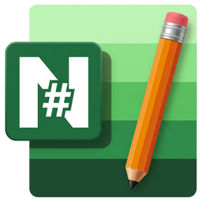

<div align="center">
  <a href="https://github.com/alsyundawy/NotepadNext-MacOS">
    
  </a>
  <h1>🍎 🐧 NotepadNext For MacOS & Linux — Notepad++ Like</h1>
</div>

> 🇬🇧 A cross-platform reimplementation of Notepad++ — built natively for macOS (DMG) and Linux (.deb / .rpm).
>
> 🇮🇩 Implementasi ulang Notepad++ lintas platform — dibangun secara native untuk macOS (DMG) dan Linux (.deb / .rpm).

[](doc/RELEASE_NOTES_0.15-08.md)
[](#installation)
[](#installation)


[](https://github.com/alsyundawy/NotepadNext-MacOS/releases)
[](#localization--language-support)
[](https://github.com/alsyundawy/NotepadNext-MacOS/)
[](https://github.com/alsyundawy/NotepadNext-MacOS/blob/master/LICENSE)
[](https://github.com/alsyundawy/NotepadNext-MacOS/issues)
[](https://github.com/alsyundawy/NotepadNext-MacOS/pulls)
[](https://www.paypal.me/alsyundawy)
[](https://github.com/user-attachments/assets/a0126f28-6dde-43da-ba14-d7c9a27de0df)
[](https://github.com/sponsors/alsyundawy)
[](https://github.com/alsyundawy/NotepadNext-MacOS/stargazers)
[](https://github.com/alsyundawy/NotepadNext-MacOS/network/members)
[](https://github.com/alsyundawy/NotepadNext-MacOS/graphs/contributors)

---


---

## Overview

> 🇬🇧 **NotepadNext For MacOS & Linux** is a native cross-platform reimplementation of Notepad++ built with modern Qt 6 (supporting Qt 6.5 through 6.12). In addition to first-class macOS builds (Apple Silicon & Intel DMG), it officially provides production-ready Linux CPack distribution packages (.deb for Debian/Ubuntu and .rpm for Fedora/RHEL/openSUSE), native desktop environment MIME integration, 470+ syntax highlighters, tabbed document workflows, Gatekeeper support, and native Indonesian & English localization.
>
> 🇮🇩 **NotepadNext For MacOS & Linux** adalah implementasi ulang native lintas platform dari Notepad++ yang dibangun menggunakan Qt 6 modern (mendukung Qt 6.5 hingga 6.12). Selain build native macOS (Apple Silicon & Intel DMG), repositori ini kini secara resmi menyediakan paket distribusi Linux CPack siap pakai (.deb untuk Debian/Ubuntu dan .rpm untuk Fedora/RHEL/openSUSE), integrasi MIME desktop Linux, penyorotan sintaks untuk 470+ format file, manajemen multi-tab dokumen, integrasi sistem macOS, serta pelokalan penuh Bahasa Indonesia dan Bahasa Inggris.

### 🌟 Latest Release Highlights (v0.15-08)

> 🇬🇧 **Version 0.15-08 Major Enterprise Upgrade & SparkNotePad Feature Integration:**
>
> - ➕ **Tab Bar Plus (+) Button**: Persistent macOS-styled `+` button on the dock tab bar for instantaneous new document creation via click or standard shortcut (`Cmd+N`).
> - 📑 **Tabbed Markdown & HTML Live Preview (`PreviewTabWidget`)**: Rich tabbed preview with GitHub-grade callouts (`[!NOTE]`, `[!TIP]`, `[!IMPORTANT]`, `[!WARNING]`, `[!CAUTION]`), DevDocs styling, word count / reading time metrics, dynamic zoom, HTML export, clipboard copy, and browser preview.
> - 🖱️ **Tab Right-Click Context Menu for `.md` & `.html`**: Contextual actions on open tabs to launch Markdown or HTML preview directly.
> - 🎨 **Themes Menu Toolbar Icon Packs & 6 Size Tiers**: Full selection of toolbar icon packs (`elegant themes`, `vibrant duotone`, `windows xp`, `notepad++ classic`, `modern ribbon`, `fugue classic`, etc.) and 6 toolbar icon sizes (`16x16`, `20x20`, `24x24`, `32x32`, `48x48`, `64x64`) with active state checkmarks and dynamic toolbar resizing.
> - 📖 **Help Menu Tabbed Documentation**: Instant access to `DocNote` (`DOCNOTE.md`) and `Changelog` (`CHANGELOG.md`) opened directly in new editor tabs.
> - ⚙️ **Preferences Dialog Dedicated "Themes & Toolbar" Tab**: Consolidated management for theme styling, dark/light toggle, window opacity, toolbar icon pack selection, and icon sizing with live icon preview.
> - 💿 **macOS Native Styled DMG Installer**: High-DPI standard and Retina background artwork, custom window geometry (680x440), left app icon, right Applications drop link, curved drag-and-drop indicator, and verified checksums.
> - 🎨 **38 Icon Pack Personalization Suite (`ToolbarIconManager`)**: Ported a complete suite of 38 icon packs (Modern SVG, Fluent, Material, Classic Notepad++, Aksara variations, Retro Windows 7/Aero, Pixel Fugue) with live runtime switching directly via toolbar right-click context menu.
> - 🛠️ **Interactive Toolbar Customization (`CustomizeToolbarDialog`)**: Dual-list drag-and-drop customization widget supporting action addition, removal, reordering, separator insertion, and instantaneous toolbar sync.
> - 📄 **Markdown Safe Live Preview Dock & Export Pipeline (`MarkdownSafePreviewDock`)**: High-performance sandboxed preview dock supporting KaTeX math formulas, Mermaid diagrams, bidirectional scroll synchronization with Scintilla editor, and export to standalone GitHub-styled HTML and vector PDF.
> - ⚡ **Editor Ergonomics Suite**:
>   - `AutoClosePairs`: Automatic closing of brackets, parentheses, and quotes with smart overtyping skip and empty-pair backspace handling.
>   - `MarkOccurrences`: Scintilla indicator-based highlight matching for all occurrences of selected tokens across the viewport.
>   - `LogAutoTimestamp`: Classic Windows Notepad `.LOG` automatic timestamping on file open.
>   - `ColorPreviewCallTip`: Instant Hex, RGB, RGBA, HSL, HSLA, and CSS color code detection with visual CallTip/tooltip swatch previews.
> - 🔍 **Forensics, Statistics, Myers Diff Engine & Cryptographic Integrity**:
>   - `TokenForensicUtils` & `DocumentStatisticsDialog`: Shannon entropy calculations, JWT header/payload decoding, reading/speaking time estimates.
>   - `CharacterInfo` & `CharacterInfoDialog`: Comprehensive Unicode 16 codepoint forensics, glyph previews, and HTML/C/CSS/JSON escape tables.
>   - `MyersDiffEngine` & `FileDiffDialog`: Longest Common Subsequence (LCS) side-by-side file comparison with synchronized dual-pane scrolling.
>   - `HashIntegrityManager` & `HashIntegrityDialog`: Constant-memory stream chunked digest verification (CRC32, MD5, SHA-1, SHA-256, SHA-512, SHA3).
> - 🍏 **macOS Deep Integration**: Updated `Info.plist` with 76 document type associations, native UTTypes, and system Services.
> - 🛡️ **100% Zero-Defect Code Quality**: Passed all `trunk check -y` audits (4,023 files verified), zero compiler warnings, 100% clean `cppcheck` and `clangd` validations, and verified DMG packaging (<32 MB).
>
> 🇮🇩 **Peningkatan Mayor Enterprise Versi 0.15-08 & Integrasi Fitur SparkNotePad:**
>
> - ➕ **Tombol Plus (+) Tab Bar**: Tombol native macOS `+` persisten di ujung tab bar docking untuk membuat dokumen baru secara instan via klik atau pintasan `Cmd+N`.
> - 📑 **Pratinjau Live Markdown & HTML Bertab (`PreviewTabWidget`)**: Widget pratinjau bertab berkinerja tinggi dengan badge callout GitHub (`[!NOTE]`, `[!TIP]`, `[!IMPORTANT]`, `[!WARNING]`, `[!CAUTION]`), penataan gaya DevDocs, metrik jumlah kata / perkiraan waktu baca, zoom dinamis, ekspor HTML, salin ke clipboard, dan pratinjau peramban web default.
> - 🖱️ **Menu Konteks Klik-Kanan Tab untuk `.md` & `.html`**: Aksi kontekstual pada tab berkas untuk membuka pratinjau langsung di tab baru atau peramban web default.
> - 🎨 **Icon Pack Toolbar & 6 Pilihan Ukuran Ikon**: Pilihan lengkap paket ikon toolbar dan 6 tingkat ukuran ikon toolbar (`16x16`, `20x20`, `24x24`, `32x32`, `48x48`, `64x64`) dengan tanda centang aktif dan penyesuaian ukuran toolbar secara instan.
> - 📖 **Dokumentasi Help Menu di Tab Editor**: Akses instan ke `DocNote` (`DOCNOTE.md`) dan `Changelog` (`CHANGELOG.md`) langsung di tab editor baru.
> - ⚙️ **Tab "Themes & Toolbar" pada Dialog Preferensi**: Tab terdedikasi untuk pengaturan palet tema, mode Dark/Light, opasitas jendela, pilihan paket ikon toolbar, dan penggeser ukuran ikon dengan pratinjau langsung.
> - 💿 **Installer DMG Bergaya Native macOS**: Artwork background standar dan Retina @2x beresolusi tinggi, geometri jendela kustom (680x440), ikon aplikasi di kiri, symlink drop Aplikasi di kanan, indikator drag-and-drop melengkung, dan validasi checksum.
> - 🎨 **Suite Personalisasi 38 Icon Pack (`ToolbarIconManager`)**: Menghadirkan 38 paket ikon lengkap (Modern SVG, Fluent, Material, Notepad++ Klasik, ragam Aksara, Retro Windows 7/Aero, Pixel Fugue) dengan pergantian langsung via menu klik-kanan toolbar.
> - 🛠️ **Kustomisasi Toolbar Interaktif (`CustomizeToolbarDialog`)**: Antarmuka dual-list drag-and-drop untuk menambah, memindahkan, menyisipkan pemisah, dan mengatur aksi toolbar secara seketika.
> - 📄 **Dock Pratinjau Aman Markdown & Pipeline Ekspor Dokumen (`MarkdownSafePreviewDock`)**: Dock pratinjau langsung berkinerja tinggi dengan dukungan formula KaTeX, diagram Mermaid, scroll sinkron dua arah dengan Scintilla, serta ekspor HTML mandiri bergaya GitHub dan dokumen PDF vektor.
> - ⚡ **Suite Ergonomi Editor**:
>   - `AutoClosePairs`: Penutupan otomatis tanda kurung dan tanda kutip dengan logika overtyping skip dan penanganan backspace pasangan kosong.
>   - `MarkOccurrences`: Penandaan indikator Scintilla untuk menyorot seluruh kemunculan teks yang dipilih pada viewport editor aktif.
>   - `LogAutoTimestamp`: Deteksi header `.LOG` ala Windows Notepad yang otomatis menyisipkan stempel tanggal/waktu saat membuka berkas catatan log.
>   - `ColorPreviewCallTip`: Deteksi kode warna Hex, RGB, RGBA, HSL, HSLA, dan CSS secara instan dengan pratinjau swatch warna visual pada CallTip editor.
> - 🔍 **Forensik, Statistik, Mesin Diff Myers & Integritas Kriptografis**:
>   - `TokenForensicUtils` & `DocumentStatisticsDialog`: Perhitungan entropi Shannon, decoding header/payload token JWT, estimasi waktu membaca/berbicara.
>   - `CharacterInfo` & `CharacterInfoDialog`: Inspeksi mendalam codepoint Unicode 16 dengan kartu visual glyph dan tabel escape HTML/C/CSS/JSON.
>   - `MyersDiffEngine` & `FileDiffDialog`: Perbandingan berkas berdampingan algoritma LCS dengan sinkronisasi scroll dua panel.
>   - `HashIntegrityManager` & `HashIntegrityDialog`: Pembuatan digest kriptografis aliran chunk memori konstan (CRC32, MD5, SHA-1, SHA-256, SHA-512, SHA3).
> - 🍏 **Integrasi Mendalam macOS**: Pembaruan `Info.plist` dengan 76 asosiasi jenis berkas, native UTTypes, dan macOS system Services.
> - 🛡️ **Kualitas Kode 100% Bebas Cacat**: Lulus seluruh audit `trunk check -y` (4.023 berkas tervalidasi), bebas peringatan kompilasi, validasi `cppcheck` & `clangd` 100% bersih, dan pengemasan DMG terverifikasi (<32 MB).
>
> 📊 **Cumulative Architecture Matrix & In-Depth Upstream Comparison**: For the comprehensive 21-dimension comparative whitepaper detailing why this edition is vastly superior to official upstream v0.15, see [In-Depth Upstream Comparison](doc/UPSTREAM_COMPARISON.md), [Release Notes 0.15-08](doc/RELEASE_NOTES_0.15-08.md), and [DOCNOTE.md](doc/DOCNOTE.md).

---

## Quickstart

```bash
# macOS: Jadikan NotepadNext sebagai default editor macOS / Set as default editor on macOS
chmod +x NotepadNext-Default-Editor.sh
./NotepadNext-Default-Editor.sh -f

# Linux (Debian, Ubuntu, Fedora, RHEL, openSUSE, Arch, etc.):
chmod +x NotepadNext-Default-Editor-Linux.sh
./NotepadNext-Default-Editor-Linux.sh -f
```

---

## Installation

> 🇬🇧 NotepadNext application builds are available for macOS and Linux. You can download the latest build directly from the [Releases](https://github.com/alsyundawy/NotepadNext-MacOS/releases) page. Choose the latest release, then check the **Assets** section at the bottom to download the `.dmg`, `.deb`, or `.rpm` file matching your operating system and hardware architecture.
>
> 🇮🇩 Build aplikasi NotepadNext tersedia untuk macOS dan Linux. Anda dapat mengunduh build terbaru langsung dari halaman [Releases](https://github.com/alsyundawy/NotepadNext-MacOS/releases). Pilih rilis terbaru, lalu lihat bagian **Assets** di bagian bawah untuk mendownload file `.dmg`, `.deb`, atau `.rpm` yang sesuai dengan sistem operasi dan arsitektur perangkat Anda.

### macOS Packages (`.dmg`)

Available canonical and matrix DMG packages for Apple Silicon (`arm64`):

| Package / Paket                      | Architecture / Arsitektur | Minimum macOS       | Qt Version / Versi Qt |
| :----------------------------------- | :------------------------ | :------------------ | :-------------------- |
| `NotepadNext-v0.15-08-arm64.dmg`     | Apple Silicon (arm64)     | macOS 12.0 Monterey | Qt 6.5 (Canonical)    |
| `NotepadNext-macOS-arm64-Qt6.5.dmg`  | Apple Silicon (arm64)     | macOS 12.0 Monterey | Qt 6.5                |
| `NotepadNext-macOS-arm64-Qt6.8.dmg`  | Apple Silicon (arm64)     | macOS 13.0 Ventura  | Qt 6.8                |
| `NotepadNext-macOS-arm64-Qt6.10.dmg` | Apple Silicon (arm64)     | macOS 14.0 Sonoma   | Qt 6.10               |
| `NotepadNext-macOS-arm64-Qt6.11.dmg` | Apple Silicon (arm64)     | macOS 15.0 Sequoia  | Qt 6.11               |
| `NotepadNext-macOS-arm64-Qt6.12.dmg` | Apple Silicon (arm64)     | macOS 15.0 Sequoia  | Qt 6.12               |

Available canonical and matrix DMG packages for Intel (`x86_64`):

| Package / Paket                    | Architecture / Arsitektur | Minimum macOS       | Qt Version / Versi Qt |
| :--------------------------------- | :------------------------ | :------------------ | :-------------------- |
| `NotepadNext-v0.15-08-x64.dmg`     | Intel (x86_64)            | macOS 11.0 Big Sur  | Qt 6.5 (Canonical)    |
| `NotepadNext-macOS-x64-Qt6.5.dmg`  | Intel (x86_64)            | macOS 11.0 Big Sur  | Qt 6.5                |
| `NotepadNext-macOS-x64-Qt6.8.dmg`  | Intel (x86_64)            | macOS 12.0 Monterey | Qt 6.8                |
| `NotepadNext-macOS-x64-Qt6.10.dmg` | Intel (x86_64)            | macOS 13.0 Ventura  | Qt 6.10               |
| `NotepadNext-macOS-x64-Qt6.11.dmg` | Intel (x86_64)            | macOS 14.0 Sonoma   | Qt 6.11               |
| `NotepadNext-macOS-x64-Qt6.12.dmg` | Intel (x86_64)            | macOS 15.0 Sequoia  | Qt 6.12               |

To resolve Gatekeeper quarantine warnings on macOS:

```bash
sudo xattr -cr "NotepadNext-v0.15-08-arm64.dmg"
sudo xattr -rd com.apple.quarantine "NotepadNext-v0.15-08-arm64.dmg"
sudo codesign --force --deep --sign - "NotepadNext-v0.15-08-arm64.dmg"
```

To install using Homebrew:

```bash
brew tap alsyundawy/notepadnext
brew install --no-quarantine notepadnext
```

### Linux Packages (`.deb` & `.rpm`)

Available native Linux CPack distribution packages:

| Package / Paket                     | Format | Distribution / Distribusi                | Architecture / Arsitektur |
| :---------------------------------- | :----- | :--------------------------------------- | :------------------------ |
| `notepadnext_0.15-08_amd64.deb`     | DEB    | Ubuntu 22.04 / 24.04, Debian 12/13, Mint | x86_64 / amd64            |
| `notepadnext_0.15-08_arm64.deb`     | DEB    | Ubuntu ARM, Debian ARM, Raspberry Pi OS  | arm64 / aarch64           |
| `notepadnext-0.15-08-1.x86_64.rpm`  | RPM    | Fedora 40/41/42, RHEL 9/10, openSUSE     | x86_64                    |
| `notepadnext-0.15-08-1.aarch64.rpm` | RPM    | Fedora ARM, openSUSE ARM                 | aarch64                   |
| `notepadnext_0.15_amd64.deb`        | DEB    | Canonical release alias (x86_64)         | x86_64 / amd64            |
| `notepadnext_0.15_arm64.deb`        | DEB    | Canonical release alias (ARM64)          | arm64 / aarch64           |
| `notepadnext-0.15-1.x86_64.rpm`     | RPM    | Canonical release alias (x86_64)         | x86_64                    |
| `notepadnext-0.15-1.aarch64.rpm`    | RPM    | Canonical release alias (AArch64)        | aarch64                   |
| `notepadnext_0.15-qt<ver>_*.deb`    | DEB    | Multi-Qt matrix (Qt 6.5, 6.8, 6.10–6.12) | amd64 / arm64             |
| `notepadnext-0.15-qt<ver>-1.*.rpm`  | RPM    | Multi-Qt matrix (Qt 6.5, 6.8, 6.10–6.12) | x86_64 / aarch64          |

Install on Debian / Ubuntu / Linux Mint (`.deb`):

```bash
# Menggunakan APT (disarankan, otomatis menangani dependensi)
sudo apt update
sudo apt install ./notepadnext_0.15-08_amd64.deb

# Atau via dpkg langsung
sudo dpkg -i ./notepadnext_0.15-08_amd64.deb
sudo apt-get install -f # pasang dependensi jika belum lengkap
```

Install on Fedora / RHEL / Rocky / AlmaLinux (`.rpm`):

```bash
sudo dnf install ./notepadnext-0.15-08-1.x86_64.rpm
```

Install on openSUSE (`.rpm`):

```bash
sudo zypper install ./notepadnext-0.15-08-1.x86_64.rpm
```

> 📖 **Comprehensive Guides & Technical Architecture:**
>
> - 📦 **[Linux Packaging Guide (.deb & .rpm)](doc/LINUX_DEB_RPM_PACKAGING.md)**: Dependency architecture, 64-bit `time_t` transition (`t64`), and DNF vs. APT deep dive.
> - 🐧 **[Native Linux Compilation Guide](doc/BUILD_UBUNTU_DEBIAN.md)**: Native build instructions for Ubuntu 22.04/24.04/26.04 and Debian 12/13.
> - 🌐 **[Platform & OS Support Matrix](doc/PLATFORM_SUPPORT.md)**: Detailed compatibility across macOS (11–26), Linux distributions, and FreeBSD.
> - 🍏 **[macOS Codesign & Quarantine Guide](doc/MACOS_CODESIGN_AND_NOTARIZATION.md)**: Gatekeeper unblocking, ad-hoc signing, and Developer ID notarization.
> - 🍺 **[Homebrew Distribution Guide](doc/HOMEBREW_DISTRIBUTION.md)**: Installing and managing NotepadNext via Homebrew Casks.

---

## Dependencies

> 🇬🇧 **System Requirements & Dependencies:**
>
> - **Operating Systems**:
>   - **macOS**: macOS 11.0 (Big Sur) or higher (Apple Silicon `arm64` & Intel `x86_64`).
>   - **Linux**: Ubuntu 22.04 / 24.04 LTS, Debian 12 / 13, Fedora 40 / 41 / 42, RHEL 9 / 10, openSUSE 15.6 / Tumbleweed, Arch Linux (`x86_64` & `aarch64`).
> - **Packaging Formats**: macOS Application Bundle (`.dmg`), Debian Package (`.deb`), Red Hat Package Manager (`.rpm`).
> - **GUI Framework**: Qt 6.5, 6.8 LTS, 6.10, 6.11, or 6.12 with `Qt6Core5Compat`.
> - **Build Tools**: CMake 3.21+, Ninja, and C++20 compiler (`AppleClang`, `GCC 11+`, or `Clang 14+`).
> - **System Integration Helpers**:
>   - macOS: `duti` (optional, for LaunchServices file associations).
>   - Linux: `xdg-utils`, `update-alternatives` (Debian/Ubuntu), or `alternatives` (Fedora/RHEL/openSUSE).
>
> 🇮🇩 **Kebutuhan Sistem & Dependensi:**
>
> - **Sistem Operasi**:
>   - **macOS**: macOS 11.0 (Big Sur) ke atas (Apple Silicon `arm64` & Intel `x86_64`).
>   - **Linux**: Ubuntu 22.04 / 24.04 LTS, Debian 12 / 13, Fedora 40 / 41 / 42, RHEL 9 / 10, openSUSE 15.6 / Tumbleweed, Arch Linux (`x86_64` & `aarch64`).
> - **Format Paket**: macOS Application Bundle (`.dmg`), Debian Package (`.deb`), Red Hat Package Manager (`.rpm`).
> - **Framework GUI**: Qt 6.5, 6.8 LTS, 6.10, 6.11, atau 6.12 dengan `Qt6Core5Compat`.
> - **Build Tools**: CMake 3.21+, Ninja, dan C++20 compiler (`AppleClang`, `GCC 11+`, atau `Clang 14+`).
> - **Integrasi Sistem**:
>   - macOS: `duti` (opsional, untuk pemetaan asosiasi file LaunchServices).
>   - Linux: `xdg-utils`, `update-alternatives` (Debian/Ubuntu), atau `alternatives` (Fedora/RHEL/openSUSE).

---

## Configuration

> 🇬🇧 **Force-set NotepadNext as the system-wide default text and code editor on macOS.**
>
> By default, macOS binds hundreds of file formats and extensionless documents to TextEdit. We provide an automated, production-ready script (`NotepadNext-Default-Editor.sh`) that associates 470+ developer file extensions and 38 UTIs, unblocks Gatekeeper quarantine flags, rebuilds the LaunchServices cache database, and restarts Finder & Dock in sub-second time.
>
> 🇮🇩 **Jadikan NotepadNext sebagai editor teks dan kode default seluruh sistem di macOS.**
>
> Secara default, macOS menetapkan ratusan format file dan dokumen tanpa ekstensi ke TextEdit. Kami menyediakan skrip otomatis (`NotepadNext-Default-Editor.sh`) yang memetakan 470+ ekstensi file developer dan 38 UTIs, menghapus karantina Gatekeeper, merefresh database LaunchServices, dan me-restart Finder & Dock secara instan (<0.3 detik).

### Features & Capabilities / Fitur & Keunggulan

| Feature / Fitur             | 🇬🇧 Description                                                                                   | 🇮🇩 Deskripsi                                                                                    |
| :-------------------------- | :----------------------------------------------------------------------------------------------- | :---------------------------------------------------------------------------------------------- |
| ⚡ **Batch Engine (<0.3s)** | Atomic LaunchServices configuration in a single pass without process spawn lag.                  | Konfigurasi atomik LaunchServices dalam 1 panggilan cepat tanpa jeda proses.                    |
| 📄 **470+ Extensions**      | Supports 470+ developer file formats across 15 categories.                                       | Mendukung 470+ format file developer lintas 15 kategori.                                        |
| 🧩 **38 System UTIs**       | Binds `public.plain-text`, `public.source-code`, `public.script`, `public.data`, etc.            | Memetakan UTI teks, skrip, dan dokumen _unknown_ tanpa ekstensi.                                |
| 🛡️ **Gatekeeper Unblock**   | Automatically strips `com.apple.quarantine` from the application bundle.                         | Menghapus atribut karantina Gatekeeper secara otomatis dari bundle aplikasi.                    |
| 🔒 **TCC / FDA Check**      | Validates Full Disk Access to avoid silent macOS permission blocks.                              | Memverifikasi Full Disk Access untuk mencegah pemblokiran izin macOS.                           |
| 🔄 **Auto Cache Refresh**   | Safely rebuilds user LaunchServices database (`lsregister -domain user`) & restarts Finder/Dock. | Membangun ulang database LaunchServices user secara aman dan me-restart Finder & Dock otomatis. |

### Command-line Options / Opsi Perintah

| Option / Opsi         | Description / Deskripsi                                                                               |
| :-------------------- | :---------------------------------------------------------------------------------------------------- |
| `-f`, `-y`, `--force` | Force replace defaults non-interactively & auto-restart Finder/Dock. _(Mode paksa & restart UI)_      |
| `-d`, `--dry-run`     | Preview all 300+ associations without applying any system changes. _(Pratinjau perubahan)_            |
| `--rebuild-cache`     | Force reset & rebuild LaunchServices database cache (_default: on_). _(Rebuild cache LaunchServices)_ |
| `--no-restart`        | Apply file associations without restarting Finder and Dock. _(Terapkan tanpa restart UI)_             |
| `-h`, `--help`        | Show usage options and help information. _(Tampilkan bantuan)_                                        |
| `-v`, `--version`     | Display script version. _(Tampilkan versi skrip)_                                                     |

To configure font smoothing to match Windows rendering:

🇬🇧 By default, macOS enables font smoothing which causes text to appear quite differently from the Windows version. This can be disabled system-wide using the following command:

🇮🇩 Secara default, macOS mengaktifkan font smoothing yang menyebabkan tampilan teks berbeda jauh dari versi Windows. Hal ini dapat dinonaktifkan secara sistem menggunakan perintah berikut:

```bash
defaults -currentHost write -g AppleFontSmoothing -int 0
```

### Linux Default Editor (`NotepadNext-Default-Editor-Linux.sh`)

> 🇬🇧 **Automate NotepadNext as the default text and code editor on Linux.**
>
> Seamlessly configure Freedesktop XDG MIME associations, Debian/Ubuntu `update-alternatives`, RHEL/Fedora/openSUSE `alternatives`, and CLI `$EDITOR`/`$VISUAL` across all major desktop environments (GNOME, KDE Plasma, XFCE, Cinnamon, MATE, LXQt, COSMIC, etc.). For comprehensive technical details, see [Linux Default Editor Architecture](doc/DEFAULT_EDITOR_LINUX.md).
>
> 🇮🇩 **Jadikan NotepadNext sebagai editor teks dan kode default di Linux.**
>
> Mengonfigurasi asosiasi XDG MIME Freedesktop, `update-alternatives` Debian/Ubuntu, `alternatives` RHEL/Fedora/openSUSE, serta variabel terminal `$EDITOR`/`$VISUAL` di semua desktop environment populer (GNOME, KDE Plasma, XFCE, Cinnamon, MATE, LXQt, COSMIC, dll). Detail teknis lengkap dapat dibaca pada [Dokumentasi Linux Default Editor](doc/DEFAULT_EDITOR_LINUX.md).

```bash
# 1. Terapkan untuk user aktif (default, ~/.config/mimeapps.list)
./NotepadNext-Default-Editor-Linux.sh -f

# 2. Terapkan untuk seluruh sistem (membutuhkan sudo, /etc/xdg/mimeapps.list)
sudo ./NotepadNext-Default-Editor-Linux.sh --system -f

# 3. Cek status asosiasi MIME saat ini
./NotepadNext-Default-Editor-Linux.sh --status

# 4. Pulihkan konfigurasi MIME awal dari backup
./NotepadNext-Default-Editor-Linux.sh --restore
```

| Option / Opsi     | Description / Deskripsi                                                      |
| :---------------- | :--------------------------------------------------------------------------- |
| `-f`, `--force`   | Configure Notepad Next as default editor non-interactively (120+ MIME types) |
| `-s`, `--system`  | Target system-wide configuration (`/etc/xdg/mimeapps.list`, requires sudo)   |
| `-u`, `--user`    | Target current user profile only (`~/.config/mimeapps.list`, default)        |
| `-d`, `--dry-run` | Simulate configuration changes without writing files                         |
| `--status`        | Audit and display current MIME associations and default editor paths         |
| `--restore`       | Restore original MIME configurations from the latest backup                  |
| `-h`, `--help`    | Display usage options and help screen                                        |

---

## Localization & Language Support

> 🇬🇧 **Native Full Indonesian & English Localization Support.**
>
> NotepadNext For MacOS & Linux features built-in support for **Bahasa Indonesia (`id_ID`)** alongside **English (`en_US`)**, covering all interface components (Menu Bar, Toolbar, Settings dialogs, Find/Replace, Editor context menus, and Shortcuts).
>
> 🇮🇩 **Dukungan Pelokalan Penuh Bahasa Indonesia & Bahasa Inggris.**
>
> NotepadNext For MacOS & Linux kini menyediakan pelokalan lengkap untuk **Bahasa Indonesia (`id_ID`)** bersama **Bahasa Inggris (`en_US`)**, mencakup seluruh komponen antarmuka aplikasi (Menu Bar, Toolbar, Dialog Pengaturan, Pencarian/Penggantian, Menu Konteks Editor, dan Pintasan Tombol).

### Cara Mengaktifkan Bahasa Indonesia / How to Switch to Indonesian

1. **Settings / Preferensi**:
   - 🇬🇧 Open **NotepadNext** $\rightarrow$ Click menu **Settings** $\rightarrow$ **Preferences...** (or press `Cmd + ,`).
   - 🇮🇩 Buka aplikasi **NotepadNext** $\rightarrow$ Klik menu **Settings** $\rightarrow$ **Preferences...** (atau tekan `Cmd + ,`).

2. **Localization Dropdown / Menu Bahasa**:
   - 🇬🇧 Under the **General** tab $\rightarrow$ Look for the **Localization** / **Language** dropdown.
   - 🇮🇩 Pada tab **General** $\rightarrow$ Cari menu pilihan dropdown **Localization** / **Language**.

3. **Select Indonesian / Pilih Bahasa Indonesia**:
   - 🇬🇧 Select **Bahasa Indonesia** from the list $\rightarrow$ Click **Close**.
   - 🇮🇩 Pilih **Bahasa Indonesia** dari daftar $\rightarrow$ Klik **Close**.

4. **Restart Application / Mulai Ulang Aplikasi**:
   - 🇬🇧 Restart NotepadNext to apply the Indonesian language across the entire application.
   - 🇮🇩 Mulai ulang (restart) NotepadNext untuk menerapkan Bahasa Indonesia ke seluruh aplikasi.

| Language / Bahasa           | Locale Code                                                                                                                              | Coverage / Cakupan                | Maintainer / Penerjemah                      |
| :-------------------------- | :--------------------------------------------------------------------------------------------------------------------------------------- | :-------------------------------- | :------------------------------------------- |
| 🇮🇩 **Bahasa Indonesia**     | `id_ID` (`id`)                                                                                                                           | Lengkap (3.550+ baris string XML) | [@alsyundawy](https://github.com/alsyundawy) |
| 🇬🇧 **English**              | `en_US` (`en`)                                                                                                                           | Base (Native)                     | [@dail8859](https://github.com/dail8859)     |
| 🌐 **20+ Global Languages** | `ar`, `cs`, `de`, `es`, `fr`, `hu`, `it`, `ja`, `ko`, `nl`, `pl`, `pt_BR`, `pt_PT`, `ru`, `sv`, `tr`, `uk`, `vi`, `zh`, `zh_CN`, `zh_TW` | Upstream Official Synchronized    | Upstream Community & Transifex               |

---

## Running Tests

> 🇬🇧 **Executing Tests & Script Diagnostics:**
>
> ```bash
> # 1. Preview default editor mappings (Dry Run Mode)
> ./NotepadNext-Default-Editor.sh --dry-run
>
> # 2. Build and verify locally with CMake & CTest
> cmake -S . -B build -DCMAKE_BUILD_TYPE=Debug
> cmake --build build --parallel
> ctest --test-dir build --output-on-failure
> ```
>
> 🇮🇩 **Menjalankan Pengujian & Diagnostik Skrip:**
>
> ```bash
> # 1. Pratinjau pemetaan editor default (Mode Dry Run)
> ./NotepadNext-Default-Editor.sh --dry-run
>
> # 2. Bangun dan verifikasi pengujian lokal dengan CMake & CTest
> cmake -S . -B build -DCMAKE_BUILD_TYPE=Debug
> cmake --build build --parallel
> ctest --test-dir build --output-on-failure
> ```

---

## Contributing

> 🇬🇧 Contributions are welcome! You can contribute bug reports, code improvements, or UI translations:
>
> - **Translations**: Managed on Crowdin at [crowdin.com/project/notepadnext](https://crowdin.com/project/notepadnext) or via direct GitHub Pull Requests for macOS & Linux resources.
> - **Pull Requests**: Please ensure all changes pass automated CI checks.
>
> 🇮🇩 Kontribusi sangat terbuka! Anda dapat mengirimkan laporan bug, perbaikan kode, atau penerjemahan antarmuka:
>
> - **Terjemahan**: Dikelola melalui Crowdin di [crowdin.com/project/notepadnext](https://crowdin.com/project/notepadnext) atau langsung melalui Pull Request GitHub untuk perbaikan macOS & Linux.
> - **Pull Requests**: Pastikan semua perubahan lolos verifikasi CI otomatis.

---

## Credits

> 🇬🇧 This repository is an enhanced **macOS & Linux edition** of the original project by **[@dail8859](https://github.com/dail8859)**.
>
> All credit for the original codebase goes to the original author.
>
> This edition is maintained at [https://github.com/alsyundawy/NotepadNext-MacOS](https://github.com/alsyundawy/NotepadNext-MacOS) to provide first-class macOS DMGs, native Linux DEB & RPM packages, deep desktop integrations, tab lifecycle stability fixes, and enterprise-grade code hardening.
>
> 🇮🇩 Repository ini merupakan **edisi khusus macOS & Linux** dari proyek asli oleh **[@dail8859](https://github.com/dail8859)**.
>
> Seluruh kredit untuk proyek aslinya diberikan kepada penulis asli.
>
> Edisi ini dikelola di [https://github.com/alsyundawy/NotepadNext-MacOS](https://github.com/alsyundawy/NotepadNext-MacOS) untuk menyediakan paket native macOS (Apple Silicon & Intel DMG), paket distribusi Linux (.deb & .rpm), integrasi editor default sistem, perbaikan stabilitas tab, dan standardisasi kualitas kode bebas cacat.

| Component / Komponen                             | Link / Tautan                                                                              |
| :----------------------------------------------- | :----------------------------------------------------------------------------------------- |
| 🏠 **Original Repository / Repositori Asli**     | [github.com/dail8859/NotepadNext](https://github.com/dail8859/NotepadNext)                 |
| 👤 **Original Author / Penulis Asli**            | [@dail8859](https://github.com/dail8859)                                                   |
| 📦 **Edition Repository / Repositori Edisi Ini** | [github.com/alsyundawy/NotepadNext-MacOS](https://github.com/alsyundawy/NotepadNext-MacOS) |
| 👤 **Lead Maintainer / Pengembang Utama**        | [@alsyundawy](https://github.com/alsyundawy)                                               |

---

## Important Notes

> 🇬🇧 Though the application overall is stable and usable, it should **not** be considered safe for critically important work. There are numerous bugs and half working implementations. Pull requests are greatly appreciated.
>
> 🇮🇩 Meskipun aplikasi secara keseluruhan stabil dan dapat digunakan, aplikasi ini **tidak** disarankan untuk pekerjaan yang sangat penting. Masih terdapat banyak bug dan fitur yang belum sempurna. Pull request sangat diterima dengan tangan terbuka.

---

## Support

> 🇬🇧 If you find this project useful and would like to support its development:
>
> 🇮🇩 Jika Anda merasa proyek ini bermanfaat dan ingin memberikan dukungan / donasi:

- 💳 **PayPal**: [](https://www.paypal.me/alsyundawy)
- 📱 **QRIS**:


---

## License

🇬🇧 This code is released under the [GNU General Public License version 3](https://www.gnu.org/licenses/gpl-3.0.txt).

🇮🇩 Kode ini dirilis di bawah [GNU General Public License versi 3](https://www.gnu.org/licenses/gpl-3.0.txt).


